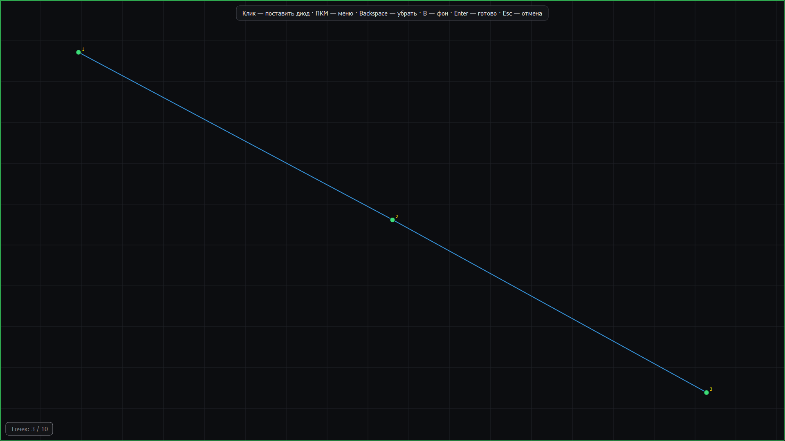

# LED Ambilight — ELK-BLEDOM / WLED

[](https://github.com/arsinema/ledambilight/actions/workflows/ci.yml)
[](https://github.com/arsinema/ledambilight/releases/latest)

Десктоп-приложение на Python/PyQt5, которое анализирует изображение с экрана
(через `dxcam`) и в реальном времени отправляет цвет на LED-ленту.

Поддерживаются три типа устройств:

| Режим | Что это | Как передаётся |
|---|---|---|
| **WLED (Wi-Fi)** | ESP32/ESP8266 с прошивкой [WLED](https://kno.wled.ge) | UDP, протокол DRGB — цвет **каждого** диода отдельно |
| **WLED (USB)** | та же плата, подключённая кабелем | Adalight по COM-порту |
| **ELK-BLEDOM (BLE)** | дешёвый Bluetooth-контроллер | BLE-характеристика, один цвет на всю ленту |

Работает только на **Windows** (dxcam и определение активного окна — Windows-only API).

## English

Desktop ambient backlight for Windows 10/11. It captures the screen and streams
per-LED colors to addressable LED strips:

- **WLED** (ESP32/ESP8266) over Wi-Fi (UDP DRGB) or USB (Adalight)
- **ELK-BLEDOM** over Bluetooth LE
- Full-screen LED layout editor: click every LED right where it is on the monitor
- Profiles, HUD mask, colour calibration, audio-reactive modes, phone remote, MQTT
- Skip the first N LEDs (leave the start of a strip dark) and keep the rest mapped
- One-click support report (logs + redacted config + mapping) and shareable presets
- Home Assistant MQTT Discovery: a light entity appears automatically
- Capture a selected window/region or monitor; English UI with a language switch
- Windows installer (per-user, Start Menu shortcut, uninstaller)
- In-app updater for the single-exe build: SHA-256 check and rollback

You need an addressable strip (WS2812B/SK6812) and a 5 V power supply. Download
the portable EXE or ZIP from
[Releases](https://github.com/arsinema/ledambilight/releases/latest).
The application UI is available in Russian and English.

Ideas and priorities for future versions: [ROADMAP.md](ROADMAP.md).

## Скачать

Готовый `LEDAmbilight.exe` (Windows 10/11, Python не нужен) лежит в разделе
**[Releases](https://github.com/arsinema/ledambilight/releases/latest)**.
Скачай файл и запусти — конфиг создастся рядом с exe при первом запуске.
Там же портативный zip: распакуй папку и запусти `LEDAmbilight.exe`
из неё — этот вариант стартует быстрее и реже вызывает вопросы антивируса.
Для обычной установки есть `LEDAmbilight-1.5.0-setup.exe`: ярлык в «Пуске»,
удаление, опционально автозапуск; права администратора не нужны.

Windows SmartScreen может показать «Неизвестный издатель»: сборка не подписана
платным сертификатом. Нажми «Подробнее» → «Выполнить в любом случае».

## Требования

**Железо**

| Что | Зачем | Замечания |
|---|---|---|
| LED-лента с адресуемыми диодами | собственно подсветка | WS2812B, SK6812 или аналог; 30–60 диодов на метр |
| ESP32 / ESP8266 с прошивкой [WLED](https://kno.wled.ge) | управление лентой по Wi-Fi | прошивается за минуту через `install.wled.me` |
| Блок питания 5 В | питание ленты | считай 55 мА на диод: 90 диодов ≈ 5 А, бери с запасом (5 В / 6–8 А) |
| Wi-Fi **2.4 ГГц** | связь с платой | ESP32 не умеет 5 ГГц — это самая частая причина «плата не находится» |

Вместо WLED можно взять дешёвый BLE-контроллер ELK-BLEDOM (тогда один цвет
на всю ленту) или подключить WLED по USB-кабелю (Adalight).

**Компьютер**

- Windows 10/11
- Python 3.10+ — только если запускаешь из исходников. Для `.exe` Python не нужен
- Видеокарта с работающим DXGI (есть везде), для HDR-игр — опционально WGC
- Для WLED по Wi-Fi: плата и компьютер в одной сети, WLED 0.13+ (проверено на 16.0.1)
- Для BLE: адаптер Bluetooth 4.0+

**Программа**

- WLED и компьютер — в одной сети; узнать IP платы можно в её веб-интерфейсе
  или в приложении WLED
- Порт 21324 (UDP) должен быть свободен — по нему идёт поток цвета
- Если включаешь пульт с телефона, разреши приложению доступ в локальную сеть
  (Windows спросит один раз при первом запуске)

## Установка

```
pip install -r requirements.txt
```

`winsdk` (автоцвет из обложки трека) намеренно не входит в основные зависимости —
см. `requirements-optional.txt`. MQTT-мост тоже опционален: без пакета
`paho-mqtt` приложение просто не включает эту функцию.

## Запуск

```
python main.py
```

Одновременно может работать только один экземпляр приложения: два окна
отправляют на одну ленту разные кадры, и она мерцает. Второй запуск
покажет сообщение и завершится.

## Сборка в .exe (чтобы запускалось без Python)

```
pip install pyinstaller
python build_exe.py
```

Готовый файл — `dist/LEDAmbilight.exe`: его можно отдать человеку без Python.
Конфиг создастся рядом с exe при первом запуске, а если папка только для
чтения (например, Program Files) — уедет в `%APPDATA%\LedAmbilight`.

Есть вариант `python build_exe.py --dir` — папка вместо одного файла:
запускается быстрее и реже вызывает ложные срабатывания антивируса.
Команда `python build_exe.py --portable` делает то же самое и сразу упаковывает
папку в `dist/LEDAmbilight-<версия>-portable.zip` — это и есть релизный архив.
Установщик собирается отдельно (нужен Inno Setup 6):

```
python build_installer.py
```

Он берёт `dist/LEDAmbilight`, кладёт результат в
`dist/installer/LEDAmbilight-<версия>-setup.exe`. Установка идёт в
`%LOCALAPPDATA%\Programs\LEDAmbilight` без прав администратора.

OpenCV для сборки и работы не нужен: dxcam отдаёт кадры в родном BGRA,
а приложение само переводит их в RGB средствами numpy (`capture.bgra_to_rgb`).

История версий — в [CHANGELOG.md](CHANGELOG.md), порядок выпуска релиза —
в [RELEASING.md](RELEASING.md).

## Быстрая настройка раскладки

Лента на задней крышке монитора? Есть два способа разложить диоды — оба
без рисования мышкой:

1. **Шаблон витков** — вкладка «Конфигурация ленты» → «Готовая раскладка»:
   выбери число витков (по периметру / два / три / четыре), угол начала,
   направление, отступ от края и шаг между витками → «Создать раскладку».
   Подходит для ленты, наклеенной кольцами, — а это самый частый вариант.
2. **Раскладка по развёртке** — кнопка «Раскладка по развёртке»: приложение
   само зажигает диоды по одному (0, 10, 20, …), а ты щёлкаешь по схеме там,
   где видишь этот свет. Около десяти кликов — и путь построен точно по факту,
   вместе с направлением и началом. Если диод не видно — «Пропустить».
3. **Вручную по местам диодов** — режим «Вручную — каждый светодиод отдельно»
   → «Расставить на весь экран». Монитор разворачивается целиком, без панели
   задач: кликай прямо по местам, где наклеены диоды. ПКМ — меню, `Backspace` —
   убрать, `Enter` — готово, `B` — показать/скрыть снимок экрана как фон.
   Если начало ленты не используется, задай в «Параметры ленты» →
   «Пропустить первых: N диодов» — они останутся тёмными, а нумерация пойдёт с N+1.



После любого способа стоит нажать «Тест-развёртку»: диоды загораются по
порядку, и видно, совпадает ли физический порядок с нарисованным. Если бежит
не в ту сторону — «Реверс пути».

## Возможности

**Устройства**
- Поиск и подключение ELK-BLEDOM по Bluetooth LE
- Подключение WLED по Wi-Fi с реальной проверкой: приложение запрашивает
  у платы `/json/info` и показывает её имя, версию и число диодов.
  Если плата не отвечает — подключение честно не состоится (раньше UDP-сокет
  открывался всегда, и «Подключено» горело даже для выключенной платы)
- Подключение WLED по USB (Adalight)
- Автоподключение к последнему устройству при запуске — для всех трёх режимов
- Автопереподключение при обрыве связи, автозапуск с Windows (через реестр)

**Цвет**
- Калибровка каналов R/G/B (gain + offset) — подгонка под конкретную ленту,
  чтобы красный был красным, а белый — белым, без постороннего оттенка.
  **Калибровка применяется и к поэтевиксельной отправке WLED**, а не только
  к одному цвету: раньше в режиме WLED с маппингом на ленту уходил «сырой»
  цвет экрана, а настройки калибровки/яркости ни на что не влияли
- **Пространственное сглаживание вдоль ленты** — каждый диод смешивается с
  соседями, поэтому на резких границах нет цветных «ступенек» (0-49%)
- **Усреднение в линейном свете** (гамма 2.2) — физически корректный средний
  цвет, тени и переходы перестают «грязниться»
- **Настраиваемая область выборки** диода (4-40 px): меньше — цвет «дёргается»,
  больше — картинка смазывается
- **Гамма** для HDR-мониторов и блёклых сцен (70-160%)
- Кнопки быстрого теста (красный/зелёный/синий/белый) держат цвет 3 секунды,
  чтобы его не затирал следующий кадр, и пересчитываются на лету при
  движении слайдеров — по ленте видно результат калибровки в реальном времени
- Минимальная яркость, автоконтроль яркости, общий множитель яркости
- **Пресеты сцен** «Кино / Игра / Ночь / Яркий день» — один клик ставит
  яркость, сглаживание и режим звука
- **Ограничение по току** — мягкое приглушение кадра, если оценка потребления
  превышает возможности блока питания
- HUD-маска — обрезка краёв экрана от анализа (интерфейс/оверлеи).
  В поэтевиксельном режиме диод, попавший в исключённую область, берёт цвет
  ближайшей разрешённой точки, а не таскбара
- **Умные зоны (авто)** — приложение само смотрит на картинку:
  - обрезает чёрные полосы фильмов (letterbox);
  - включает кино-профиль, если на экране кино (независимо от плеера);
  - находит статичный интерфейс игр (миникарта, полоса здоровья) и уводит
    выборку диодов из-под него;
  - плавно приглушает подсветку, когда видео стоит на паузе
- Настраиваемая область анализа (30-100%, рекомендуется 50-80%)
- Порог изменения цвета — не спамим BLE-команды на микро-изменения
- Фильтр мерцания (медианный фильтр по короткому окну кадров)
- Адаптивное сглаживание — резкие смены сцены отрабатывают быстрее,
  спокойные сцены сглаживаются плавнее (работает и для каждого диода отдельно)
- Приоритет доминирующего цвета кадра (опционально, смешивается со средним)

**Профили**
- Три профиля захвата (desktop / movie / game), переключаются автоматически
  по активному процессу
- Редактируемый список игровых процессов, список «процесс → профиль»
  (браузеры и плееры по умолчанию идут в movie) и отдельный выбор профиля
  для неизвестных приложений (по умолчанию desktop)

**Производительность**
- Зонный анализ считается на уменьшенной копии кадра: **44 мс → 3.7 мс на кадр**
  (×12), поэтому потолок FPS теперь задаёт настройка «целевой FPS» (для WLED),
  а не вычисления. Раньше на WLED реальные 60 FPS упирались в 33 кадра/с
  игрового профиля — задержка профиля подбиралась под медленный BLE и теперь
  для WLED не применяется
- **Адаптивная частота кадров**: на статичной картинке захват опускается до
  заданного минимума — меньше нагрузка на процессор и на Wi-Fi платы
- Буфер захвата урезан до минимума, превью не генерируется, пока вкладка
  «Просмотр захвата» не открыта
- **Два бэкенда захвата**: DXGI (быстрый) и WGC — работает в HDR и в играх с
  эксклюзивным полным экраном. WGC — опциональный пакет `windows-capture`,
  без него приложение автоматически использует DXGI

**Звук**
- Аудио-реактивная подсветка (вкладка «Звук»), четыре режима:
  - **Гибрид** — цвет с экрана, яркость/оттенок подмешиваются от баса и высоких
  - **Вспышки на пиках** — обычный Ambilight + белая вспышка на пиках
  - **Полный визуализатор** — цвет и яркость целиком из звука
  - **Спектроанализатор** — 32 полосы частот раскладываются по диодам
    (левый край — бас, правый — высокие), с автоподстройкой под громкость
- Живой VU-метр, выбор устройства вывода, чувствительность и усиление по полосам

**Разметка ленты**
- Рисование пути ленты мышкой (прямые отрезки, свободное рисование
  несколькими штрихами, ручная расстановка каждого диода)
- **Полноэкранная расстановка диодов**: весь монитор без панели задач, клик
  по каждому реальному месту; фон-снимок включается клавишей `B`
- **Пропуск первых N диодов**: если начало ленты спрятано или не используется,
  оно остаётся тёмным, а подсветка и нумерация начинаются с N+1
- Кнопка **«Реверс пути»** — разворачивает путь задом наперёд, если лента
  физически наклеена в обратную сторону и тест-развёртка бежит не в ту сторону
- Тест-развёртка (диоды зажигаются по одному) для проверки физического порядка
  и направления ленты; развёртку можно отменить, она не блокирует приложение
- Маппинг сохраняется/загружается в JSON, пропорционально подгоняется под
  реальное разрешение экрана

**Дежурный режим**
- «Дыхание» выбранным цветом, когда Ambilight не запущен: фиксированный цвет,
  погода (wttr.in) или обложка текущего трека (Windows SMTC)

**Надёжность**
- Конфиг сохраняется атомарно (`.tmp` → `os.replace`, плюс копия `.bak`),
  повреждённый файл не теряется, а откладывается как `config.json.broken`
- Если папка приложения недоступна для записи, конфиг автоматически
  переезжает в `%APPDATA%\LedAmbilight\config.json`
- Ошибки фонового потока не убивают его молча: они попадают в лог, в строку
  статуса и в трей, а цикл перезапускается
- При остановке захвата и при выходе лента не остаётся с «замёрзшим» кадром:
  отправляется чёрный кадр и снимается realtime-режим WLED (плата возвращается
  к своему эффекту)
- Таймер сна реально выключает подсветку (раньше только останавливал захват)

**Наблюдение и управление**
- Строка состояния показывает частоту кадров, задержку отправки, число
  пакетов и оценку потребления
- **Кнопка «Выход»** в нижней строке окна завершает приложение сразу, даже если
  включено «Сворачивать в трей при закрытии»: крестик по-прежнему только
  прячет окно, а кнопка и пункт «Выход» в меню трея закрывают программу
- **Проверка и установка обновлений** (вкладка «Система»): приложение
  спрашивает у GitHub номер последнего релиза. Для onefile-сборки кнопка
  «Скачать и обновить» скачивает exe, проверяет SHA-256, показывает прогресс и
  после перезапуска подменяет файл с откатом при ошибке. Для portable/установки
  открывается страница релиза. Проверку при запуске можно выключить; наружу
  уходит только версия в User-Agent
- **Отчёт для поддержки** (вкладка «Система»): ZIP с логами, конфигом без
  IP/MAC, текущим маппингом и диагностикой — приложи его к issue
- **Пресеты `.ledpreset`**: экспорт/импорт сцен, калибровки, фильтров и
  маппинга; сетевые настройки в пресет не попадают
- **Захват окна или области**: протяни прямоугольник в «Система» → «Захват
  экрана», и анализируется только он; «Весь экран» возвращает обычный режим
- **Выбор монитора**: «Система» → «Монитор» — второй экран захватывается
  отдельно, координаты диодов считаются от его разрешения
- **Английский интерфейс**: переключатель «Язык / Language» в «Системе»
- **Установщик Windows**: установка без прав администратора, ярлык в «Пуске»,
  удаление; портативный zip и одиночный exe остаются
- Кнопка **«Диагностика»**: проверяет связь с платой, её версию, число диодов,
  уровень Wi-Fi, состояние захвата и маппинга — и подсказывает, что не так
- **Превью зон диодов**: на вкладке «Просмотр захвата» можно наложить на кадр
  области, из которых берёт цвет каждый диод
- **Горячие клавиши** (работают из любого приложения):
  `Ctrl+Alt+L` — пуск/стоп, `Ctrl+Alt+↑/↓` — яркость,
  `Ctrl+Alt+B` — погасить, `Ctrl+Alt+D` — диагностика;
  `Ctrl+Q` — выход из приложения
- **Автопауза** при блокировке экрана (`Win+L`) и при простое; не срабатывает,
  пока идёт видео или игра в полноэкранном режиме либо активен профиль
  movie/game, — лента не гаснет посреди фильма
- **Мастер первого запуска** — пять шагов от подключения до первой развёртки
- **Тест-паттерн раскладки**: схема всех диодов на весь экран одновременно
  с развёрткой — проще всего сверить, где какой диод на самом деле
- **Пульт с телефона**: встроенный веб-сервер, `http://<ip-компьютера>:8765` —
  включение, яркость, сцены, звук, гашение. Ничего ставить не нужно
- **MQTT / Home Assistant** (опционально, нужен `paho-mqtt`): состояние в
  `<префикс>/state`, команды в `<префикс>/set`; с включённым Discovery
  Home Assistant сам создаёт light-сущность (вкл/выкл, яркость, доступность)

**Сцены и автоматизация**
- **Пресеты сцен** «Кино / Игра / Ночь / Яркий день» — один клик ставит
  яркость, сглаживание и режим звука
- **Сцены для приложений**: «cs2.exe = Игра» — при активации окна сцена
  включается сама (кнопка «Привязать активное окно»)
- **Расписание**: днём одна сцена, ночью другая, по времени
- **Рассвет-будильник**: плавно разгорается от тёплого к белому к заданному часу
- **Режим «Лампа»**: лента как светильник — ровный белый с выбором температуры
  и яркости

## Логи

`%LOCALAPPDATA%\LedAmbilight\app.log` (ротация по 1 МБ, 3 файла).

## Самотест

```
python selftest.py
```

Проверяет без железа: векторный и скалярный цветовой пайплайн, калибровку,
HUD-маску, маппинг ленты, форматы DRGB и Adalight, слияние конфига.

## Структура проекта

```
main.py                      — точка входа: логи, High-DPI, защита от второго экземпляра
selftest.py                  — самотест без железа
ledapp/__init__.py           — версия приложения (показывается в нижней строке окна)
ledapp/config.py             — дефолты, загрузка/атомарное сохранение config.json
ledapp/logging_setup.py      — настройка логирования в файл и консоль
ledapp/hotkeys.py            — глобальные горячие клавиши (RegisterHotKey)
ledapp/win_utils.py          — блокировка экрана и время простоя для автопаузы
ledapp/frame_analysis.py     — чёрные полосы, статичный HUD, определение паузы
ledapp/remote.py             — пульт с телефона (встроенный HTTP-сервер)
ledapp/mqtt_bridge.py        — мост в MQTT / Home Assistant
ledapp/ble_controller.py     — ELK-BLEDOM: поиск/подключение/отправка команд
ledapp/wled_controller.py    — WLED: UDP DRGB + HTTP API (проверка, питание, realtime)
ledapp/wled_serial_controller.py — WLED по USB (Adalight)
ledapp/capture.py            — захват экрана, зоны/квадранты, HUD, определение профиля
ledapp/color_engine.py       — калибровка, фильтры, сглаживание, доминантный цвет
ledapp/worker.py             — фоновый поток (asyncio) + Qt-сигналы
ledapp/updates.py            — проверка обновлений через GitHub Releases
ledapp/updater.py            — скачивание, SHA-256 и подмена exe с откатом
ledapp/support_bundle.py     — ZIP-отчёт для поддержки (логи, конфиг, маппинг)
ledapp/presets.py            — экспорт/импорт пресетов настроек и маппинга
ledapp/i18n.py               — переключение языка и перевод виджетов
ledapp/locales_en.py         — английский каталог строк
ledapp/audio_engine.py       — захват системного звука (loopback) и анализ
ledapp/strip_mapper.py       — сопоставление диодов координатам экрана
ledapp/weather.py            — цвет по погоде для дежурного режима
ledapp/now_playing.py        — «сейчас играет» через Windows SMTC
ledapp/autostart.py          — автозапуск с Windows через реестр
ledapp/gui.py                — главное окно, вкладки настроек
ledapp/style.py              — тёмная тема (QSS)
```

## Протоколы

**ELK-BLEDOM (BLE)** — характеристика записи `0000fff3-0000-1000-8000-00805f9b34fb`,
команда цвета `7E 07 05 03 R G B 0A EF`.

**WLED (UDP, DRGB)** — байт 0: `2`, байт 1: таймаут в секундах,
далее R,G,B для каждого диода. Максимум 490 диодов за пакет
([документация](https://kno.wled.ge/interfaces/udp-realtime/)).

**WLED (USB, Adalight)** — `'A' 'd' 'a'` + `(count-1)` как uint16 BE + checksum
(`hi XOR lo XOR 0x55`) + RGB-данные.

## Известные ограничения

- Протокол DRGB передаёт максимум 490 диодов за пакет — приложение предупредит,
  если в конфиге больше
- У ESP32 со слабым Wi-Fi HTTP-сервер иногда отвечает с задержкой 2-3 секунды;
  поэтому проверка подключения делает две попытки, а статус «не отвечает»
  выставляется только после двух провалов подряд
- Смена Wi-Fi сети платы делается через её собственную точку доступа
  (вкладка «Настройка WiFi (ESP)» открывает нужную страницу WLED):
  WLED не позволяет передать SSID/пароль через API
